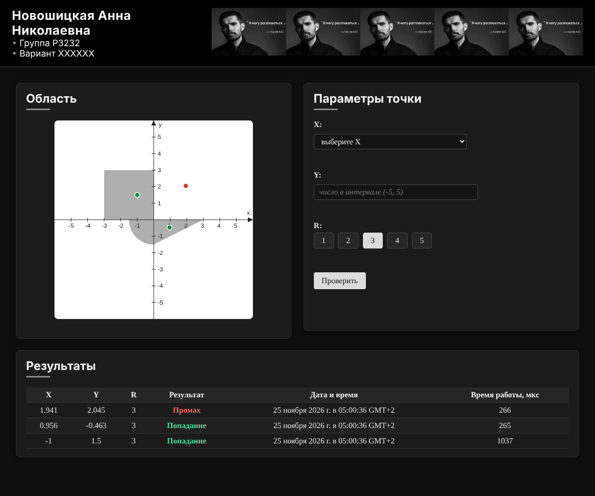
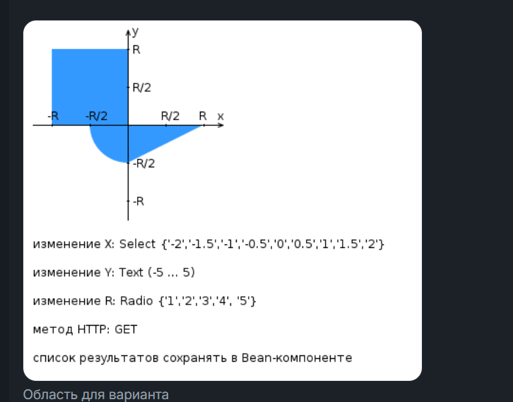
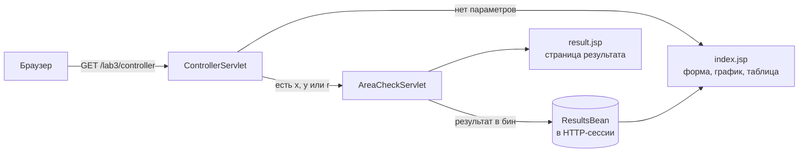

# Лабораторная работа №3 — сервлеты и JSP

Веб-приложение на Java-сервлетах и JSP, которое проверяет, попадает ли точка на координатной плоскости в заданную область. Построено по шаблону MVC и развёрнуто на сервере приложений WildFly.

**Студентка:** Новошицкая Анна Николаевна, группа P3232, вариант 57415392



## Задание

Разработать веб-приложение на базе сервлетов и JSP, определяющее попадание точки на координатной плоскости в заданную область.

Приложение реализуется по шаблону MVC и состоит из следующих элементов:

- **ControllerServlet** — определяет тип запроса и, в зависимости от того, содержит ли запрос координаты точки и радиус, передаёт его одному из компонентов ниже. Все запросы внутри приложения идут только через этот сервлет (методом GET), остальные сервлеты со страниц напрямую не вызываются.
- **AreaCheckServlet** — проверяет попадание точки в область и формирует HTML-страницу с результатом. Обрабатывает все запросы, в которых есть координаты точки и радиус.
- **Страница JSP** — формирует HTML-страницу с веб-формой. Обрабатывает все запросы без координат и радиуса.

Страница JSP содержит:

- шапку с ФИО студента, номером группы и номером варианта;
- форму, отправляющую данные на сервер;
- поля для координат точки и радиуса области (см. вариант ниже);
- сценарий на JavaScript, проверяющий значения в полях формы;
- интерактивное изображение области: если радиус задан, клик по изображению определяет координаты точки и отправляет их на сервер для проверки, иначе выводится сообщение о невозможности определить координаты. После проверки изображение обновляется с учётом результата;
- таблицу с результатами предыдущих проверок; список результатов хранится в Bean-компоненте.

Страница, которую возвращает AreaCheckServlet, содержит таблицу с полученными параметрами, результат (попала точка в область или нет) и ссылку на страницу с формой.

Приложение развёрнуто на сервере WildFly в standalone-конфигурации; порты настроены по выданному portbase, http listener доступен для всех IP.

## Вариант



| Параметр | Элемент формы | Значения |
|---|---|---|
| X | Select | -2, -1.5, -1, -0.5, 0, 0.5, 1, 1.5, 2 |
| Y | Text | интервал (-5, 5) |
| R | Radio | 1, 2, 3, 4, 5 |
| Метод HTTP | — | GET |
| Хранение результатов | — | Bean-компонент |

Область (границы входят):

| Четверть | Фигура | Условие |
|---|---|---|
| II | прямоугольник | -R ≤ x ≤ 0, 0 ≤ y ≤ R |
| III | четверть круга радиуса R/2 | x² + y² ≤ (R/2)² |
| IV | треугольник (0, 0), (R, 0), (0, -R/2) | y ≥ x/2 - R/2 |
| I | — | точек области нет |

## Как это работает



- **ControllerServlet** отображён на корень приложения и `/controller`. Если в запросе есть хотя бы один из параметров `x`, `y`, `r`, он передаёт запрос в AreaCheckServlet, иначе — на страницу с формой.
- **AreaCheckServlet** объявлен в `web.xml` без `url-pattern`, поэтому из браузера он недоступен. Контроллер вызывает его через `getNamedDispatcher`.
- **JSP-страницы** лежат в `WEB-INF/jsp` и тоже недоступны напрямую, только через forward из сервлетов.
- **ResultsBean** хранит историю проверок. `SessionListener` кладёт новый бин в каждую новую HTTP-сессию, поэтому у каждого пользователя своя история.
- **Ошибки ввода** проверяются дважды: в браузере (`script.js`) и на сервере (`RequestParser`). На неверные данные сервер отвечает кодом 400 и страницей с текстом ошибки, на метод POST — кодом 405.
- **Время проверки** сервер передаёт в миллисекундах UTC, а браузер показывает его в часовом поясе устройства.

## Структура проекта

```
lab3/
├── build.gradle, settings.gradle   сборка Gradle
├── gradlew, gradlew.bat, gradle/   Gradle wrapper
├── src/main/java/lab3/
│   ├── controller/   ControllerServlet, AreaCheckServlet, SessionListener
│   └── model/        Point, RequestParser, AreaChecker, CheckResult, ResultsBean
├── web/
│   ├── WEB-INF/      web.xml, jsp/index.jsp, jsp/result.jsp
│   └── static/       style.css, script.js, img/
├── server/           run.sh, setup-wildfly.sh — запуск на Helios
└── docs/             картинки для README
```

## Технологии

- Java 17, Jakarta Servlet 6.0, JSP, JSTL
- WildFly 34 (Jakarta EE 10)
- HTML, CSS, JavaScript (Canvas)
- Gradle

## Сборка

```bash
./gradlew war          # Linux / macOS
.\gradlew.bat war      # Windows
```

Готовый архив появится в `build/libs/lab3.war`. Для сборки нужен JDK 17 или новее.

## Локальный запуск

1. Скачать [WildFly 34.0.1.Final](https://github.com/wildfly/wildfly/releases/tag/34.0.1.Final) и распаковать.
2. Скопировать `build/libs/lab3.war` в `<WildFly>/standalone/deployments/`.
3. Запустить `<WildFly>/bin/standalone.sh` (на Windows — `standalone.bat`) и дождаться строки `Deployed "lab3.war"`.
4. Открыть http://localhost:8080/lab3/

Если порт 8080 занят, можно сдвинуть все порты сервера: `standalone.sh -Djboss.socket.binding.port-offset=100`, тогда адрес — http://localhost:8180/lab3/

## Развёртывание на Helios

Скрипт `server/run.sh` запускается на своём компьютере и сам выполняет нужные команды на сервере по SSH. Перед первым запуском в нём нужно указать `PORTBASE` и, если нужно, путь к WildFly на сервере.

```bash
./server/run.sh setup   # один раз: порты по portbase, http listener на 0.0.0.0
./server/run.sh push    # собрать war, залить на сервер, перезапустить WildFly, поднять SSH-туннель
./server/run.sh         # только перезапуск и туннель
./server/run.sh stop    # остановить WildFly и туннель
```

После запуска приложение доступно через туннель: http://localhost:8080/lab3/
